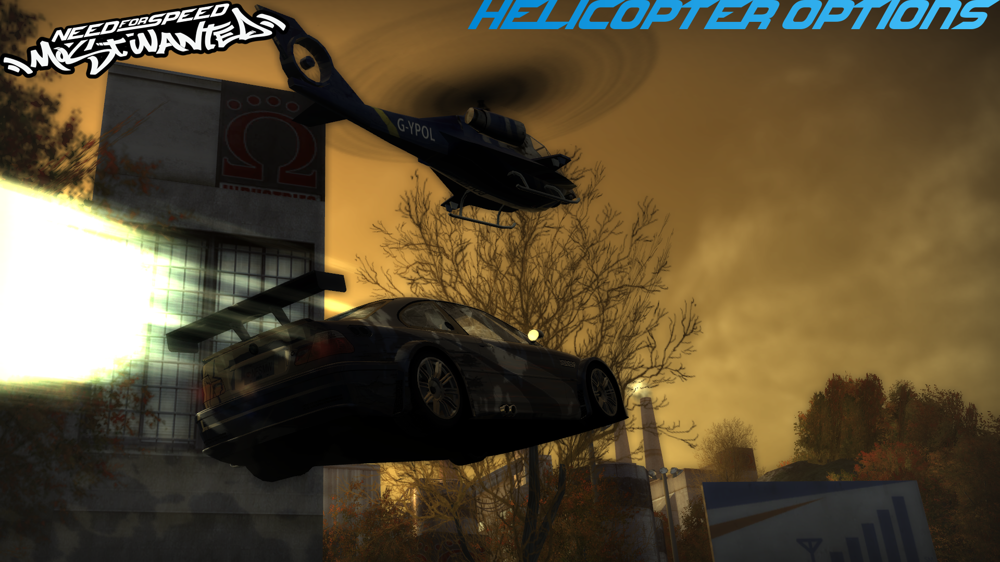

# NFSMWHelicopterOptions

An ASI mod for **Need for Speed: Most Wanted (2005)**, PC v1.3, that controls how the police helicopter chases, flies, sees, spawns and refuels. The settings are split over two files in `scripts\HelicopterOptions\Configuration`: `General.ini` holds the everyday ones (spawn distance, top speed, sight, fuel, attack length, search speed and leaving speed), and `Advanced.ini` holds the finer AI and flight-model tuning (leading, closing speed, search radius, turning, acceleration, braking and the heli sheet). Every setting can have its own value at each Heat level from 1 to 10, with separate values for races.

## Installation

1. Copy `NFSMWHelicopterOptions.asi` and the `HelicopterOptions` folder into the `scripts` folder in your game directory, and launch the game.

The settings are in `scripts\HelicopterOptions\Configuration\General.ini` and `Advanced.ini` next to it.

## Credits

- `Eatincrispies` (Mod creator)
- `Fierelier` - (MinGW support)
- `Roskler` (Mod tester)
